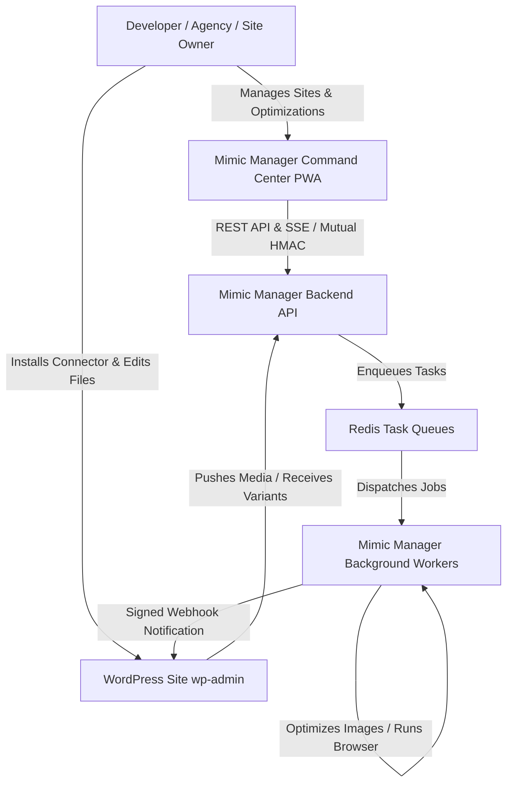
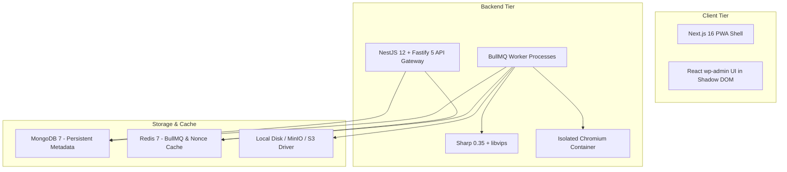
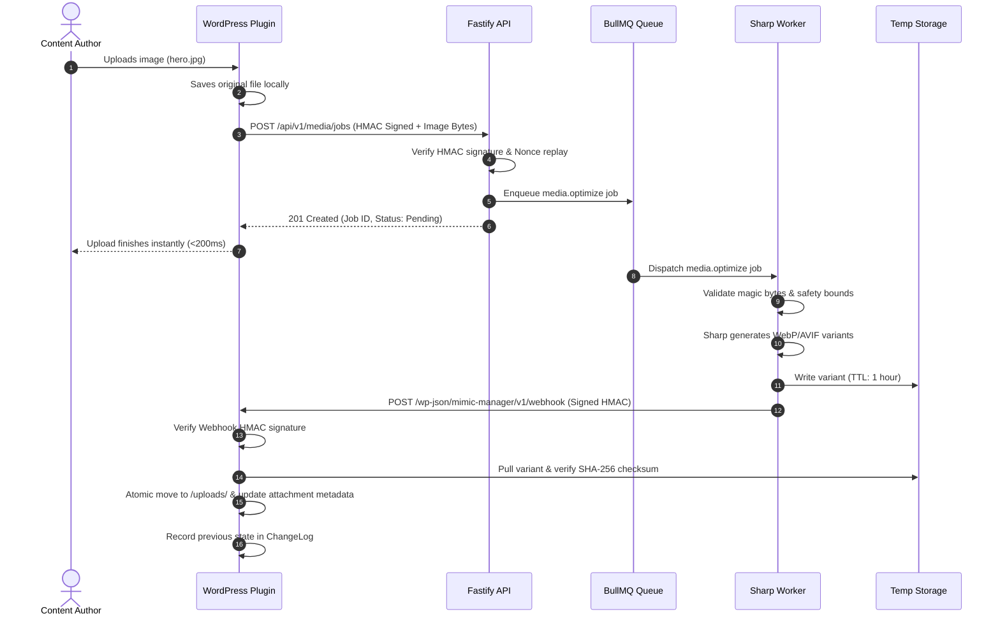
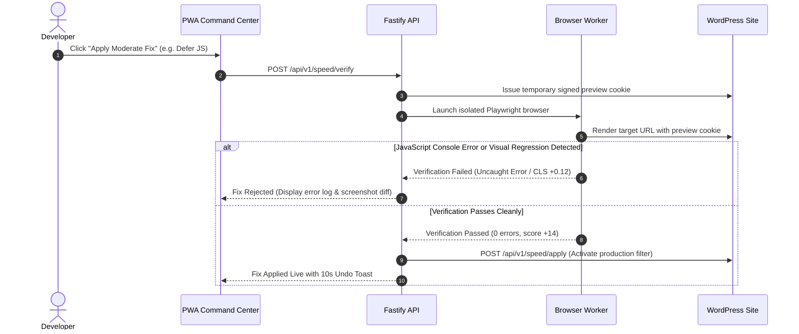

# System Architecture & Technical Blueprint

**Status:** ACTIVE  
**Owner-persona:** Principal Systems Architect & Senior Security Engineer  
**Last-reviewed:** 2026-10-29  
**Applies-to-version:** v0.1.0-alpha  
**Related-docs:** [DATA_MODEL.md](file:///home/dayshift/Pictures/Mimic%20Manager/docs/architecture/DATA_MODEL.md), [API.md](file:///home/dayshift/Pictures/Mimic%20Manager/docs/architecture/API.md), [FIX_REGISTRY.md](file:///home/dayshift/Pictures/Mimic%20Manager/docs/architecture/FIX_REGISTRY.md), [docs/security/THREAT_MODEL.md](file:///home/dayshift/Pictures/Mimic%20Manager/docs/security/THREAT_MODEL.md)

---

## 1. C4 Architecture Models

### 1.1 Context Diagram (C4 Level 1)


### 1.2 Container Diagram (C4 Level 2)


---

## 2. Runtime Sequence Views

### 2.1 Media Optimization Pull-Model Sequence


### 2.2 PageSpeed Fix Verification & Auto-Revert Sequence


---

## 3. Module Boundaries & Dependency Enforcement

```
packages/types       <-- Base contract (Zero internal dependencies)
packages/ssrf-guard  <-- Imports @mimic-manager/types
packages/fixes       <-- Imports @mimic-manager/types
packages/ir          <-- Imports @mimic-manager/types
packages/ui          <-- Design system (Standalone React/CSS)
apps/api             <-- Imports types, ssrf-guard
apps/worker          <-- Imports types, ssrf-guard
apps/pwa             <-- Imports types, ui
connectors/wordpress <-- Independent PHP runtime (GPL-2.0+)
```

---

## 4. Failure Mode & Self-Healing Matrix

| Component | Failure | Blast Radius | Detection | Automated System Action |
|---|---|---|---|---|
| **Backend API** | Process crash / OOM | External optimization paused | Docker healthcheck fails | Container restarts automatically; WordPress plugin activates local GD/Imagick fallback. |
| **Worker Process**| Decompression bomb | Single worker task killed | Memory limit violation | Task rejected with `MEDIA_DECOMPRESSION_BOMB`; worker respawns cleanly. |
| **Redis** | Redis network timeout | Queued jobs temporarily paused | Connection error event | BullMQ pauses queue; retries with exponential backoff and jitter. |
| **WordPress Host**| External HTTP blocked | Plugin cannot reach backend | 3 consecutive connect timeouts | Circuit breaker trips; switches site to local-only optimization without throwing errors. |
