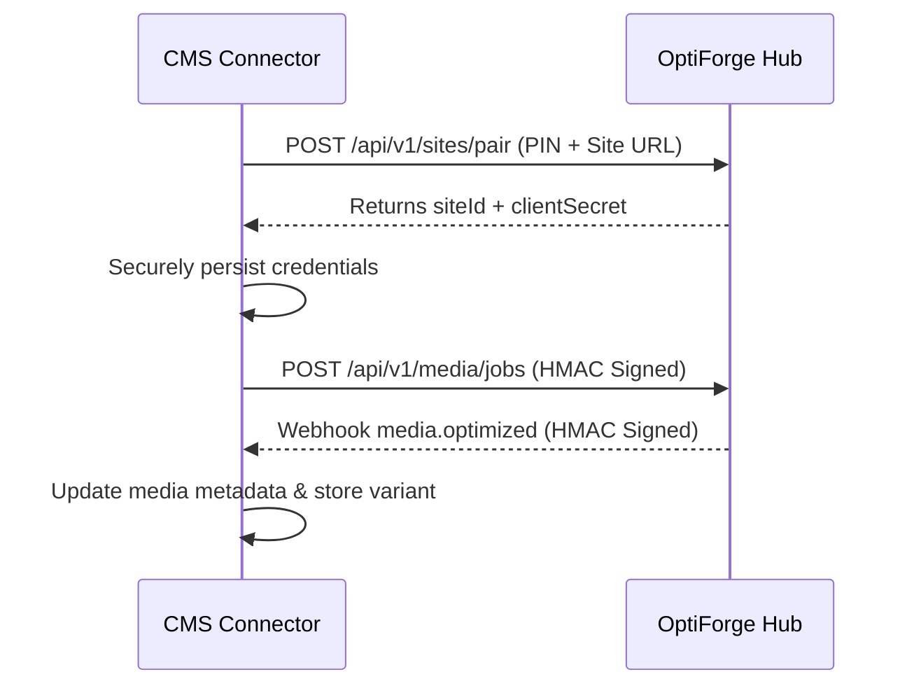

# OptiForge Connector Authoring Guide

**Status:** ACTIVE  
**Owner-persona:** Platform Ecosystem Architect & Lead Integration Engineer  
**Last-reviewed:** 2026-10-29  
**Applies-to-version:** v1  
**Related-docs:** [WORDPRESS_PLUGIN.md](file:///home/dayshift/Pictures/Mimic%20Manager/docs/architecture/WORDPRESS_PLUGIN.md), [API.md](file:///home/dayshift/Pictures/Mimic%20Manager/docs/architecture/API.md), [SECURITY_ARCHITECTURE.md](file:///home/dayshift/Pictures/Mimic%20Manager/docs/security/SECURITY_ARCHITECTURE.md)

---

## 1. Overview
While WordPress is the primary reference connector, OptiForge is architected as a headless optimization brain capable of powering any CMS or static site framework (Shopify, Drupal, Next.js, Astro).

This guide specifies how to author a native CMS connector adhering to the OptiForge integration protocol.

---

## 2. Core Connector Responsibilities

Every connector must satisfy the following 4 pillars:
1. **Cryptographic Handshake & Pairing:**
   - Display a 6-digit one-time pairing PIN in the CMS admin.
   - Negotiate a shared secret with the OptiForge hub via `POST /api/v1/sites/pair`.
   - Store the resulting `siteId` and `clientSecret` securely in the CMS configuration store.
2. **Mutual HMAC Authentication:**
   - Sign all outbound requests using `sha256=${timestamp}.${nonce}.${siteId}.${body}`.
   - Verify signatures on inbound webhooks from the hub.
3. **Local Action Scheduler / Background Worker:**
   - Process image attachment conversions asynchronously.
   - Avoid blocking user uploads or front-end page rendering.
4. **Audit & Changelog Logging:**
   - Maintain a local atomic rollback log before applying any HTML or database modification.

---

## 3. Reference Implementation Lifecycle

---

## 4. Review Log

| Reviewer Persona | Verdict | Findings & Mitigations |
| :--- | :--- | :--- |
| **Ecosystem Architect** | APPROVED | Confirmed protocol decoupling allows building Shopify and Drupal connectors using the identical REST/HMAC API. |
| **Security Engineer** | APPROVED | Mandated constant-time comparison on all signature validations in new connector implementations. |
