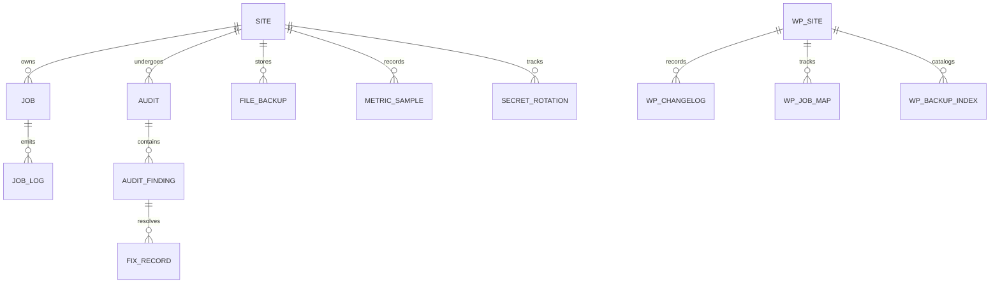
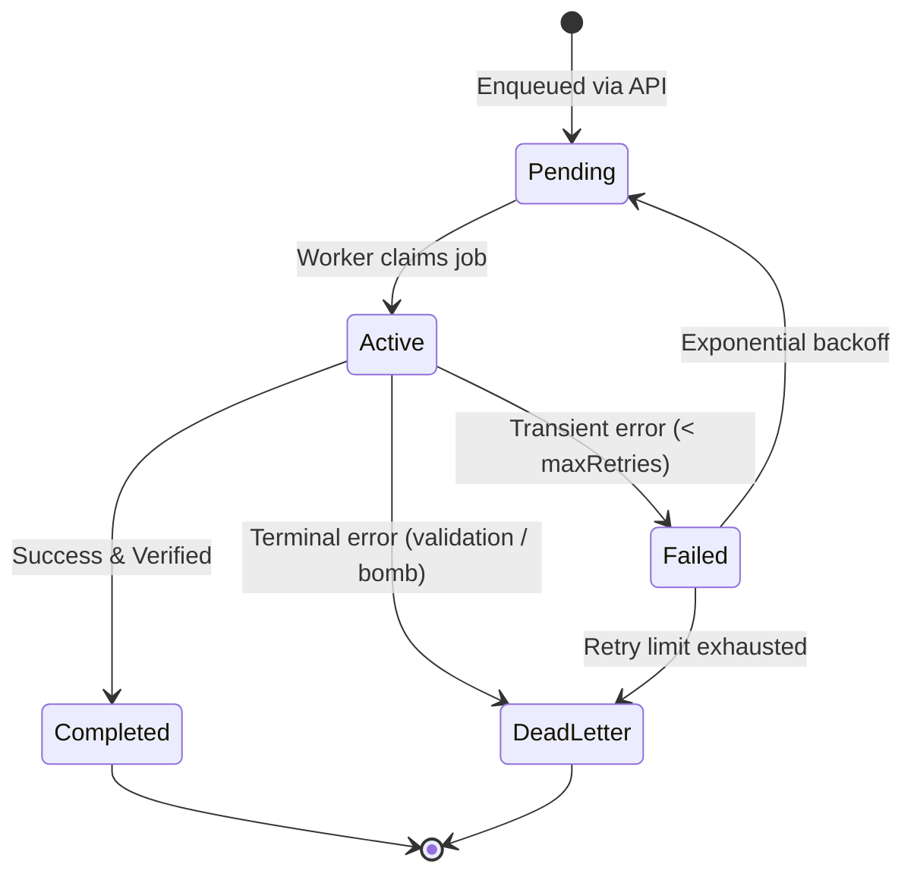

# OptiForge Data Model & Persistence Specification

**Status:** ACTIVE  
**Owner-persona:** Database Architect & Senior Backend Engineer  
**Last-reviewed:** 2026-10-29  
**Applies-to-version:** v0.1.0-alpha  
**Related-docs:** [ARCHITECTURE.md](file:///home/dayshift/Pictures/Mimic%20Manager/docs/architecture/ARCHITECTURE.md), [API.md](file:///home/dayshift/Pictures/Mimic%20Manager/docs/architecture/API.md), [STORAGE.md](file:///home/dayshift/Pictures/Mimic%20Manager/docs/architecture/STORAGE.md), [SECURITY_ARCHITECTURE.md](file:///home/dayshift/Pictures/Mimic%20Manager/docs/security/SECURITY_ARCHITECTURE.md)

---

## 1. Overview & Purpose
This document defines the single source of truth for all data stored across the OptiForge platform. It encompasses both the centralized backend data store (MongoDB 7 / PostgreSQL hybrid) and the WordPress connector local database tables.

### How to Read This Document
- Section 2 defines the Entity-Relationship (ER) model across centralized and distributed domains.
- Section 3 details the MongoDB document schemas, field types, indexing, TTL, and encryption status.
- Section 4 documents the WordPress MySQL/MariaDB database tables with exact `dbDelta` DDL.
- Section 5 establishes state transition machines for Jobs, Audits, and File Backups.
- Section 6 outlines schema versioning, migration lifecycle, and data retention rules.

---

## 2. Entity-Relationship Diagram



---

## 3. Centralized Store: MongoDB Collections

### 3.1 Collection: `sites`
Primary registry of paired websites managed by the OptiForge instance.

| Field Name | Type | Required | Index / Constraint | TTL | PII | Encryption | Description |
| :--- | :--- | :--- | :--- | :--- | :--- | :--- | :--- |
| `_id` | `ObjectId` | Yes | Primary Key | None | No | None | MongoDB internal unique identifier |
| `siteId` | `String (UUIDv4)` | Yes | Unique index | None | No | None | Public immutable identifier |
| `name` | `String` | Yes | Standard index | None | No | None | Human-readable site label |
| `homeUrl` | `String (URL)` | Yes | Unique index | None | No | None | Canonical URL of site root |
| `clientSecretHash` | `String` | Yes | None | None | No | Argon2id | Hash of HMAC shared secret |
| `encryptedSecret` | `String` | Yes | None | None | No | AES-256-GCM | KMS-encrypted secret for webhook signing |
| `environment` | `Enum` | Yes | None | None | No | None | `'production'` \| `'staging'` \| `'development'` |
| `circuitBreaker` | `Object` | Yes | None | None | No | None | Sub-document: `{ state, failures, lastFailure }` |
| `capabilities` | `Array<String>` | Yes | None | None | No | None | Detected plugins: `['yoast', 'rank_math', 'webp']` |
| `createdAt` | `Date` | Yes | None | None | No | None | Timestamp of pairing |
| `updatedAt` | `Date` | Yes | None | None | No | None | Timestamp of last modification |

**Invariants:**
- `homeUrl` must start with `http://` or `https://` and must not resolve to private RFC1918 addresses unless `environment === 'development'`.
- `clientSecretHash` is salted and non-invertible.

---

### 3.2 Collection: `jobs`
Tracks asynchronous optimization, conversion, and crawl tasks.

| Field Name | Type | Required | Index / Constraint | TTL | PII | Encryption | Description |
| :--- | :--- | :--- | :--- | :--- | :--- | :--- | :--- |
| `_id` | `ObjectId` | Yes | Primary Key | None | No | None | Internal unique ID |
| `jobId` | `String (UUIDv4)` | Yes | Unique index | None | No | None | Public idempotency key |
| `siteId` | `String (UUIDv4)` | Yes | Compound (`siteId`, `status`) | None | No | None | Foreign reference to `sites.siteId` |
| `type` | `Enum` | Yes | Standard index | None | No | None | `'media_convert'` \| `'pagespeed_audit'` \| `'alt_generate'` |
| `status` | `Enum` | Yes | Compound index | None | No | None | `'pending'` \| `'active'` \| `'completed'` \| `'failed'` |
| `payload` | `Object` | Yes | None | None | No | None | Type-specific task input parameters |
| `result` | `Object` | No | None | None | No | None | Execution outcome and metrics |
| `error` | `Object` | No | None | None | No | None | Standard error schema `{ code, message, stack }` |
| `retryCount` | `Number` | Yes | Default: 0 | None | No | None | Retry attempts count |
| `expiresAt` | `Date` | Yes | TTL Index: 30 days | 30d | No | None | Auto-expiration cutoff |
| `createdAt` | `Date` | Yes | Standard index | None | No | None | Creation timestamp |
| `updatedAt` | `Date` | Yes | None | None | No | None | Update timestamp |

---

### 3.3 Collection: `audits`
Stores historical PageSpeed, SEO, and accessibility audit results.

| Field Name | Type | Required | Index / Constraint | TTL | PII | Encryption | Description |
| :--- | :--- | :--- | :--- | :--- | :--- | :--- | :--- |
| `_id` | `ObjectId` | Yes | Primary Key | None | No | None | Internal unique ID |
| `auditId` | `String (UUIDv4)` | Yes | Unique index | None | No | None | Public audit reference |
| `siteId` | `String (UUIDv4)` | Yes | Compound (`siteId`, `createdAt`) | None | No | None | Site reference |
| `targetUrl` | `String (URL)` | Yes | Standard index | None | No | None | Exact audited URL |
| `scores` | `Object` | Yes | None | None | No | None | Scores: `{ perf: 85, a11y: 92, bp: 100, seo: 96 }` |
| `metrics` | `Object` | Yes | None | None | No | None | CWV: `{ lcp: 1420, fid: 12, cls: 0.01, inp: 80 }` |
| `findings` | `Array<Object>` | Yes | None | None | No | None | List of detected optimization gaps |
| `expiresAt` | `Date` | Yes | TTL Index: 90 days | 90d | No | None | Data retention limit |
| `createdAt` | `Date` | Yes | Standard index | None | No | None | Audit execution timestamp |

---

## 4. WordPress Connector Database Tables

The WordPress connector uses custom tables for high-frequency logs and atomic rollback indexes, created and upgraded via `dbDelta()`.

### 4.1 Table: `wp_optiforge_changelog`
Records every mutation performed by the connector (speed tweaks, metadata updates, code injections) with exact pre-mutation state for 1-click rollback.

```sql
CREATE TABLE {$wpdb->prefix}optiforge_changelog (
    id bigint(20) unsigned NOT NULL AUTO_INCREMENT,
    action_id varchar(64) NOT NULL,
    fix_id varchar(64) NOT NULL,
    entity_type varchar(32) NOT NULL,
    entity_id varchar(128) NOT NULL,
    tier enum('safe','moderate','guided') NOT NULL DEFAULT 'safe',
    previous_state longtext NOT NULL,
    applied_state longtext NOT NULL,
    status enum('applied','reverted','failed') NOT NULL DEFAULT 'applied',
    applied_by bigint(20) unsigned NOT NULL DEFAULT 0,
    created_at datetime NOT NULL DEFAULT CURRENT_TIMESTAMP,
    reverted_at datetime NULL DEFAULT NULL,
    PRIMARY KEY  (id),
    KEY action_id (action_id),
    KEY fix_id (fix_id),
    KEY entity (entity_type, entity_id),
    KEY created_at (created_at)
) {$charset_collate};
```

---

### 4.2 Table: `wp_optiforge_job_map`
Maintains mapping between backend BullMQ task IDs and local Action Scheduler job IDs for idempotency and pull synchronization.

```sql
CREATE TABLE {$wpdb->prefix}optiforge_job_map (
    id bigint(20) unsigned NOT NULL AUTO_INCREMENT,
    remote_job_id varchar(64) NOT NULL,
    local_action_id bigint(20) unsigned NOT NULL,
    attachment_id bigint(20) unsigned NOT NULL DEFAULT 0,
    job_type varchar(32) NOT NULL,
    status enum('pending','processing','synced','failed') NOT NULL DEFAULT 'pending',
    attempts int(10) unsigned NOT NULL DEFAULT 0,
    last_error text NULL,
    created_at datetime NOT NULL DEFAULT CURRENT_TIMESTAMP,
    updated_at datetime NOT NULL DEFAULT CURRENT_TIMESTAMP ON UPDATE CURRENT_TIMESTAMP,
    PRIMARY KEY  (id),
    UNIQUE KEY remote_job_id (remote_job_id),
    KEY attachment_id (attachment_id),
    KEY status (status)
) {$charset_collate};
```

---

### 4.3 Table: `wp_optiforge_backups`
Tracks filesystem shadow backups generated prior to Visual File Manager edits.

```sql
CREATE TABLE {$wpdb->prefix}optiforge_backups (
    id bigint(20) unsigned NOT NULL AUTO_INCREMENT,
    backup_id varchar(64) NOT NULL,
    relative_path varchar(512) NOT NULL,
    sha256_original char(64) NOT NULL,
    sha256_backup char(64) NOT NULL,
    storage_path varchar(512) NOT NULL,
    file_size bigint(20) unsigned NOT NULL,
    created_by bigint(20) unsigned NOT NULL,
    created_at datetime NOT NULL DEFAULT CURRENT_TIMESTAMP,
    restored_at datetime NULL DEFAULT NULL,
    PRIMARY KEY  (id),
    UNIQUE KEY backup_id (backup_id),
    KEY relative_path (relative_path(191)),
    KEY created_at (created_at)
) {$charset_collate};
```

---

## 5. State Transition Machines

### 5.1 Optimization Job Lifecycle


---

## 6. Schema Migrations & Data Retention

### 6.1 Centralized Migrations
- Executed via database migration scripts in `apps/api/src/migrations/`.
- Every migration must provide both `up()` and `down()` methods and be strictly idempotent.

### 6.2 Data Retention Policy
1. **Audit Logs:** Automatically purged after 90 days via MongoDB TTL index on `expiresAt`.
2. **Transient Job Payloads:** Purged after 30 days; only summary statistics preserved in aggregates.
3. **Connector Shadow Backups:** Local backups pruned to keep a maximum of 10 revisions per file, or maximum 30 days age, unless flagged as pinned.

---

## 7. Review Log

| Reviewer Persona | Verdict | Findings & Mitigations |
| :--- | :--- | :--- |
| **Principal Database Architect** | APPROVED | Confirmed strict compound indexes on `(siteId, status)` and `(siteId, createdAt)` to prevent unindexed scan overhead on high-throughput queue polling. |
| **Security Engineer** | APPROVED | Validated that `clientSecretHash` uses Argon2id with per-site salt, and encrypted keys use AES-256-GCM. Confirmed no plain secrets stored. |
