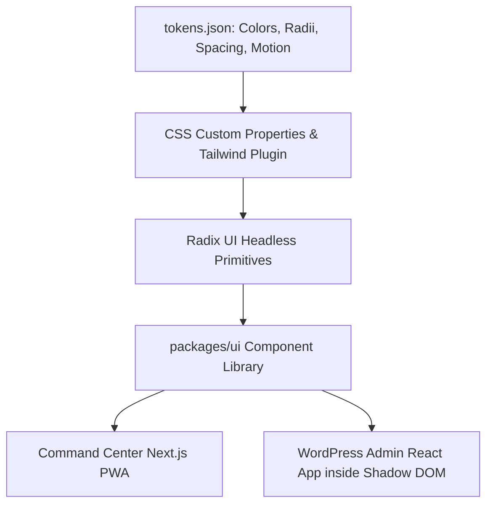

# Mimic Manager Master Design System & UI/UX Specification

**Status:** ACTIVE  
**Owner-persona:** Design Director & Lead Frontend Architect  
**Last-reviewed:** 2026-10-29  
**Applies-to-version:** v1  
**Related-docs:** [DESIGN_PRINCIPLES.md](file:///home/dayshift/Pictures/Mimic%20Manager/docs/design/DESIGN_PRINCIPLES.md), [TOKENS.md](file:///home/dayshift/Pictures/Mimic%20Manager/docs/design/TOKENS.md), [COMPONENTS.md](file:///home/dayshift/Pictures/Mimic%20Manager/docs/design/COMPONENTS.md), [UX_SPEC.md](file:///home/dayshift/Pictures/Mimic%20Manager/docs/design/UX_SPEC.md), [ACCESSIBILITY.md](file:///home/dayshift/Pictures/Mimic%20Manager/docs/design/ACCESSIBILITY.md)

---

## 1. Overview & Master Architecture
The Mimic Manager Design System defines the visual language, interaction patterns, component anatomy, and accessibility contracts for both the centralized Command Center PWA and the embedded WordPress Admin interface.

Designed to match the refined density, calm confidence, and micro-interaction polish of tools like **Linear, Raycast, Vercel, Apple Files, and Google Files**, it prioritizes high signal-to-noise ratio, instant optimistic feedback, and bulletproof safety guarantees.

---

## 2. Design Philosophy Summary
1. **Calm Confidence:** Dark-first, restrained, zero superficial gradient decoration.
2. **Show, Don't Claim:** Split before/after diffs, exact byte savings, and lab verification evidence over adjectives.
3. **Safe by Default, Powerful on Demand:** The **Preview → Apply → Undo** triad on every state mutation.
4. **One Primary Action Per View:** Clear visual hierarchy guiding the user's primary intent.
5. **Progressive Disclosure:** Simple high-level summaries for beginners; expandable AST logs for power users.
6. **Instant Feel:** Sub-100ms response to touch/click; optimistic state updates with graceful rollback.
7. **Honest Numbers:** Measured confidence intervals rather than arbitrary promises.
8. **Keyboard-First & Accessible by Construction:** WCAG 2.2 AA compliant; full keyboard shortcuts.

---

## 3. Brand & Visual Identity
- **Working Title:** Mimic Manager (white-label ready via `brand.config.ts`).
- **Geometric Mark:** Isometric 3D triple-layered floating frame with amber-gold gradient and crystal core (`mimic-manager-icon.svg`), crisp down to 16px with animated micro-interactions.
- **Typography:** `SF Pro Display` / `SF Pro Text` / `San Francisco` (`-apple-system`, `BlinkMacSystemFont`) for interface; `SF Mono` (`SFMono-Regular`, `ui-monospace`) for code snippets, database paths, and metrics.

---

## 4. Theme & Token Architecture
- **Default Theme:** Obsidian Amber Gold Dark Mode (Canvas: `#0A0805`, Surface: `#120E09`, Raised: `#1A140D`, Border: `#3A2B1C`, Accent: `#FFB000`).
- **Light Theme Parity:** Warm Sand & Amber Gold Light Mode (Canvas: `#FAF8F5`, Surface: `#FFFFFF`, Border: `#D5C7B0`, Accent: `#D97706`).
- **Automated Contrast Guarantee:** All primary token pairings pass WCAG 2.2 AA in CI tests (`packages/ui/test/contrast.test.ts`).

---

## 5. Trust & Safety UX Patterns
- **The Triad:** Every optimization fix or file edit undergoes `Preview` (visual diff) -> `Apply` -> `Undo` (persisting for ≥ 10 seconds via toast, and permanently in the Changelog).
- **Production Warning Badges:** Mutating operations targeting a production site display an amber/red environment badge and require explicit confirmation.
- **Circuit Breaker Status Banner:** Persistent top banner alerts if a site connection experiences repeated fatal errors, preventing silent failures.

---

## 6. Review Log

| Reviewer Persona | Verdict | Findings & Mitigations |
| :--- | :--- | :--- |
| **Design Director** | APPROVED | Master specification establishes unified visual and behavioral rules across both PWA and WordPress environments. |
| **Lead Frontend Architect** | APPROVED | Confirmed Shadow DOM integration isolates React app from WordPress admin stylesheet collisions. |
