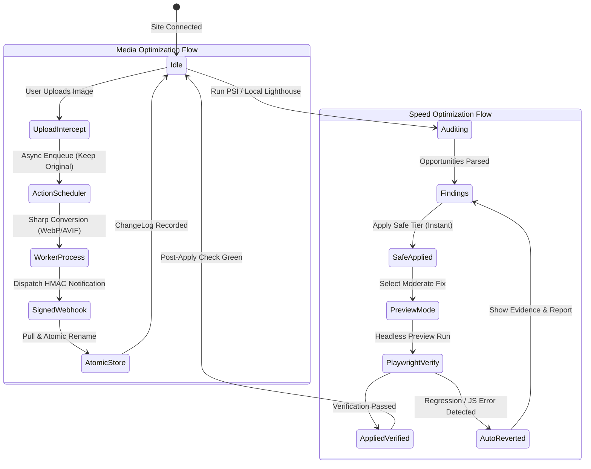

# Information Architecture & Navigation System

**Status:** ACTIVE  
**Owner-persona:** Lead UI/UX Architect  
**Last-reviewed:** 2026-10-29  
**Applies-to-version:** v0.1.0-alpha  
**Related-docs:** [docs/product/PRD.md](file:///home/dayshift/Pictures/Mimic%20Manager/docs/product/PRD.md), [DESIGN.md](file:///home/dayshift/Pictures/Mimic%20Manager/docs/design/DESIGN.md), [UX_SPEC.md](file:///home/dayshift/Pictures/Mimic%20Manager/docs/design/UX_SPEC.md)

---

## 1. Master Sitemap

```mermaid
graph TD
  Root[Mimic Manager App Root] --> CC[Command Center PWA]
  Root --> WP[WordPress Admin Plugin]
  Root --> Standalone[Standalone Tools Mode]

  %% Command Center PWA
  CC --> Dash[1. Overview Dashboard]
  CC --> Sites[2. Multi-Site Manager]
  CC --> Media[3. Media Engine]
  CC --> Speed[4. Speed & CWV]
  CC --> SEO[5. SEO Engine]
  CC --> Rep[6. UI Replicator]
  CC --> Files[7. Visual File Manager]
  CC --> Jobs[8. Jobs & Queue]
  CC --> Reports[9. PDF Reports]
  CC --> Monitor[10. Scheduled Monitoring]
  CC --> Settings[11. Settings & Security]

  %% Sub-views
  Sites --> SiteDetail[Site Health & Toggles]
  Sites --> SitePair[Pairing Flow / QR Code]
  Media --> MediaLib[Library Table / Grid]
  Media --> BulkWizard[Bulk Optimization Wizard]
  Media --> ReviewQueue[AI Alt-Text Review Queue]
  Speed --> AuditRunner[Lighthouse & CWV Audit]
  Speed --> FixRegistry[Tiered Fixes Safe/Mod/Guided]
  Speed --> VerifyViewer[Playwright Evidence Diff]
  SEO --> SeoAudit[Audit Issues Browser]
  SEO --> SeoPlan[Plan Diff & Gap Fill]
  Rep --> VisualPicker[Interactive Section Picker]
  Rep --> ReplicatorStudio[Multi-Viewport IR Studio]
  Files --> FileBrowser[Jailed Browser Grid/List/Columns]
  Files --> MonacoEditor[Syntax-Checked Code Editor]
```



---

## 2. PWA Desktop Layout Architecture (≥ 1024px)

```
+-----------------------------------------------------------------------------------------+
| [LOGO] Mimic Manager   [Site: Client Production (PROD)] v  [⌘K Search...]  [Queue: 3] [User]|
+---------------+---------------------------------------------------------+---------------+
| • Overview    | Section Title                         [Action Button]   | (Optional     |
| • Sites (42)  +---------------------------------------------------------+  Contextual   |
| • Media       |                                                         |  Inspector    |
| • Speed       | [Hero KPI Cards]                                        |  Panel)       |
| • SEO         |                                                         |               |
| • Replicator  | [Main Interactive Data Surface: Table / Grid / Canvas]  | • File Info   |
| • Files       |                                                         | • Diff View   |
| • Jobs        |                                                         | • Fix Risks   |
| • Reports     |                                                         | • History     |
| • Monitoring  |                                                         |               |
| • Settings    |                                                         |               |
+---------------+---------------------------------------------------------+---------------+
| Status: Connected | Storage: 4.2 GB | Latency: 18ms                     [Theme Toggle]  |
+-----------------------------------------------------------------------------------------+
```

### Key Desktop Interaction Patterns:
- **Collapsible Left Navigation Rail:** Icons + clear labels, badge counters on active jobs.
- **Persistent Global Header:**
  - Contextual Site Switcher with prominent red-tinted environment pill for `PRODUCTION` to prevent accidents.
  - Global Command Palette (`⌘K` / `Ctrl+K`) for immediate fuzzy jump to any site, file, or action.
  - Live Background Job indicator with spinner and numeric progress counter.
- **Contextual Inspector Panel (Right Drawer):** Displays deep metadata, before/after image diffs, or file permissions without navigating away from the current view.

---

## 3. PWA Mobile Layout Architecture (< 768px)

On mobile and touch devices, Mimic Manager transforms into a focused bottom-navigation shell:
- **Bottom Navigation Bar (5 Primary Tabs):**
  1. **Overview:** KPIs, status, next recommended action.
  2. **Sites:** Quick health check across client sites.
  3. **Jobs:** Active background optimization progress and history.
  4. **Tools:** Quick access to Standalone Image Converter and Alt-Text Generator.
  5. **More:** Settings, Reports, Documentation.
- **Sheet Architecture:** Modals are replaced with sliding bottom sheets with native drag-to-dismiss gestures.
- **Touch Target Density:** All interactive buttons and list rows meet the ≥ 44px touch target standard.
- **OS Share Sheet Integration:** Registered as a Web Share Target in Android/iOS to accept images directly from the camera roll into the converter.

---

## 4. WordPress Admin Integration Architecture

To ensure zero style contamination with diverse WordPress themes and third-party plugins:
1. **Isolated Shadow DOM Mounting:**
   ```html
   <div id="mimic-manager-admin-root">
     #shadow-root (open)
       <style>/* Scoped Mimic Manager CSS Variables & Tailwind Tokens */</style>
       <div class="mimic-manager-app">...</div>
   </div>
   ```
2. **Top-Level Admin Menu:** `Mimic Manager` top-level menu with child pages:
   - Dashboard
   - Media Library Optimization
   - Speed & Core Web Vitals
   - SEO Gap-Fill
   - File Manager (Security Jailed)
   - Settings & Pairing
3. **Native Media Library Extension:**
   - Injects a native "Mimic Manager Status" column into the standard WordPress `upload.php` table showing format, savings percentage, and "Restore Original" trigger.
4. **Kill-Switch Accessibility:** A fixed admin bar icon provides instant access to "Safe Mode" or "Pause Background Processing" if site issues arise.

---

## 5. Core Flow State Machine


