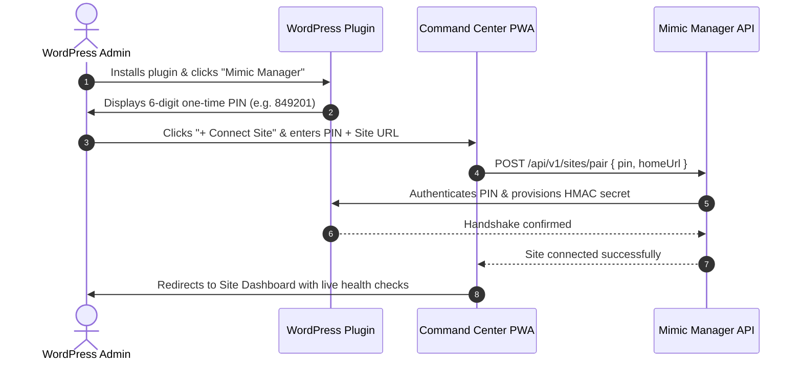

# Mimic Manager User Experience (UX) Flow & Interaction Specification

**Status:** ACTIVE  
**Owner-persona:** Lead UX Architect & Interaction Designer  
**Last-reviewed:** 2026-10-29  
**Applies-to-version:** v1  
**Related-docs:** [SCREEN_INVENTORY.md](file:///home/dayshift/Pictures/Mimic%20Manager/docs/design/SCREEN_INVENTORY.md), [DESIGN.md](file:///home/dayshift/Pictures/Mimic%20Manager/docs/design/DESIGN.md), [PRD.md](file:///home/dayshift/Pictures/Mimic%20Manager/docs/product/PRD.md)

---

## 1. Overview
This specification details the user flows, screen interactions, input contracts, and error recovery paths for Mimic Manager's core journeys.

---

## 2. Hero Flow 1: 6-Digit Zero-Config Site Pairing

---

## 3. Hero Flow 2: Bulk Media Optimization Wizard

1. **Step 1: Scope & Preset Selection:** User selects target folders/categories, format presets (WebP, AVIF, or both), and quality sliders with real-time before/after sample preview.
2. **Step 2: Estimation & Confirmation:** Modal displays estimated time, CPU workload, and projected byte savings (e.g., "Estimated savings: 420 MB across 1,840 images").
3. **Step 3: Live Progress Execution:** Segmented progress bar with real-time SSE stream (`job.progress`), showing current thumbnail processing, per-item status, and pause/resume buttons.
4. **Step 4: Results Summary & Undo:** Summary card reports exact bytes saved, conversion ratio, and provides an expandable per-file list with 1-click restore for any individual image.

---

## 5. Hero Flow 3: PageSpeed Speed Audit & 1-Click Verification

1. **Step 1: Audit Launch:** User clicks "Run mobile audit". Progress ring animates through lab crawl stages (Lighthouse warmup, trace recording, CWV extraction).
2. **Step 2: Findings Triage:** Findings are grouped by tier: Safe (Green), Moderate (Yellow), Guided (Blue).
3. **Step 3: Preview Modal:** Clicking "Preview" on a Moderate fix launches a headless Chromium sandbox diff modal showing:
   - Visual before/after screenshot overlay with difference slider.
   - Captured console log diff (ensuring 0 runtime errors).
   - Core Web Vitals projected delta (e.g. LCP: 2.4s -> 1.7s).
4. **Step 4: Apply & Auto-Revert:** Administrator clicks "Apply Fix". If any runtime regression or visual delta > 1.0% occurs, the system immediately auto-reverts the fix, displays an explanatory banner, and logs the incident in the Changelog.

---

## 6. Review Log

| Reviewer Persona | Verdict | Findings & Mitigations |
| :--- | :--- | :--- |
| **Lead UX Architect** | APPROVED | Confirmed all 3 hero flows provide full visibility and non-blocking background task execution. |
| **Support Lead** | APPROVED | Validated 1-click individual image restoration in bulk media summary eliminates support tickets for unexpected conversions. |

---

## 7. UI/UX V2 Refactor Specification (`PLUGIN-UI-V2`)

### 7.1 Single-Page Application (SPA) Shell & HashRouter (`UX-V2-001`, `UX-V2-002`, `UX-V2-003`)
- **Route Table:**
  - `#/dashboard` -> Overview metrics, compact status badge strip, quick action buttons.
  - `#/media` -> Media library optimization, bulk wizard, WebP conversion statistics.
  - `#/speed` -> PageSpeed Fix Registry (Safe, Moderate, Guided), preview diffs.
  - `#/seo` -> Missing alt-text and meta description audits, AI gap fill.
  - `#/files` -> 3-Pane visual file manager with Monaco editor overlay.
  - `#/settings` -> Telemetry consent, engine toggle, sudo mode configuration.
  - `#/about` -> Author attribution, legal licenses, system info.
- **Routing Engine:** `HashRouter` ensures WordPress Core preserves ownership of `admin.php?page=mimic-manager`. Legacy submenu bookmarks (`page=mimic-manager-media`, etc.) redirect automatically to matching hashes.
- **Zero Full-Reload Guarantee:** Tab switching triggers no main-frame reloads and 0 `document` type network requests.

### 7.2 Full-Bleed Mount & WP Admin Breakout (`UX-V2-007`, `UX-V2-008`, `UX-V2-009`)
- **Scoped Class:** Scoped exclusively under `.mm-fullbleed` body class injected via `admin_body_class` on the `mimic-manager` screen.
- **Viewport Dimensioning:**
  - `height: calc(100dvh - var(--wp-admin--admin-bar--height, 32px));`
  - Fallback: `calc(100vh - 32px)` desktop, `calc(100vh - 46px)` on mobile screens (`<= 782px`).
  - Zero double scrollbars: page body does not scroll; internal panels scroll with custom slim scrollbars.
- **Notice Relocation Tray:** Core and external plugin admin notices are moved into a collapsible `
` in the app header so they are preserved without breaking layout geometry.

### 7.3 Palette & Design System Tokens (`UX-V2-010`)
- **Surfaces:** Canvas `#0A0A0B` (Deep Space), Panels `#161618` (Graphite), Raised `#1F1F23`, Overlay `#28282E`, Border `#27272B` (subtle) / `#8E8E9A` (strong).
- **Accents:** Cyan `#00E5FF` (primary actions, dark text `#0A0A0B` on cyan), Violet `#7B61FF` (selection indicators, status rings).
- **Typography:** Inter for UI and tables; JetBrains Mono for paths, hashes, code, and JSON; Tabular figures (`tabular-nums`) on all counts and byte sizes.

### 7.4 3-Pane Sandboxed File Manager (`UX-V2-012` - `UX-V2-017`)
- **Left Tree Pane:** Fixed 250px (resizable 200px - 400px via keyboard-accessible splitter). Jailed root: `wp-content`. Core nodes `wp-admin` and `wp-includes` rendered with lock icon, locked by default.
- **Top Action Bar:** Sticky toolbar with New File, New Folder, Upload, Bulk Compress, Mimic Engine, View toggle, Refresh, and Search. Honest disabled-with-reason tooltips when write mode is off.
- **Center Data Grid:** High-density table (32px rows), multi-selection (click, Ctrl/Cmd+click, Shift+range, Cmd+A), columns (Name, Modified, Size, Permissions). Double-click folder navigates; double-click file opens editor.
- **Monaco Editor Overlay:** Sliding full-height modal with syntax highlighting, pre-save PHP AST validation, and shadow backups.
- **Right Details Inspector:** Collapsible panel showing file metadata, SHA256 checksum, backup versions, and dimensions.

