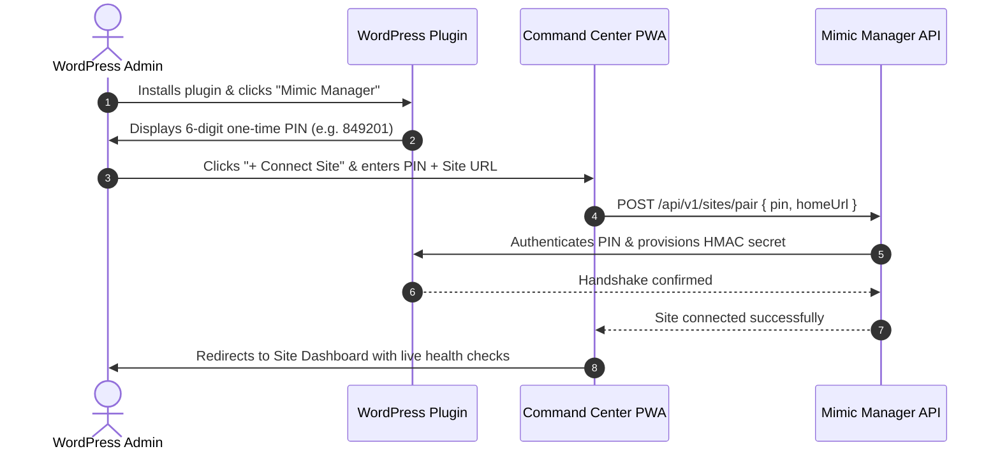

# Mimic Manager User Experience (UX) Flow & Interaction Specification

**Status:** ACTIVE  
**Owner-persona:** Lead UX Architect & Interaction Designer  
**Last-reviewed:** 2026-10-29  
**Applies-to-version:** v1  
**Related-docs:** [SCREEN_INVENTORY.md](file:///home/dayshift/Pictures/Mimic%20Manager/docs/design/SCREEN_INVENTORY.md), [DESIGN.md](file:///home/dayshift/Pictures/Mimic%20Manager/docs/design/DESIGN.md), [PRD.md](file:///home/dayshift/Pictures/Mimic%20Manager/docs/product/PRD.md)

---

## 1. Overview
This specification details the user flows, screen interactions, input contracts, and error recovery paths for Mimic Manager's core journeys.

---

## 2. Hero Flow 1: 6-Digit Zero-Config Site Pairing

---

## 3. Hero Flow 2: Bulk Media Optimization Wizard

1. **Step 1: Scope & Preset Selection:** User selects target folders/categories, format presets (WebP, AVIF, or both), and quality sliders with real-time before/after sample preview.
2. **Step 2: Estimation & Confirmation:** Modal displays estimated time, CPU workload, and projected byte savings (e.g., "Estimated savings: 420 MB across 1,840 images").
3. **Step 3: Live Progress Execution:** Segmented progress bar with real-time SSE stream (`job.progress`), showing current thumbnail processing, per-item status, and pause/resume buttons.
4. **Step 4: Results Summary & Undo:** Summary card reports exact bytes saved, conversion ratio, and provides an expandable per-file list with 1-click restore for any individual image.

---

## 5. Hero Flow 3: PageSpeed Speed Audit & 1-Click Verification

1. **Step 1: Audit Launch:** User clicks "Run mobile audit". Progress ring animates through lab crawl stages (Lighthouse warmup, trace recording, CWV extraction).
2. **Step 2: Findings Triage:** Findings are grouped by tier: Safe (Green), Moderate (Yellow), Guided (Blue).
3. **Step 3: Preview Modal:** Clicking "Preview" on a Moderate fix launches a headless Chromium sandbox diff modal showing:
   - Visual before/after screenshot overlay with difference slider.
   - Captured console log diff (ensuring 0 runtime errors).
   - Core Web Vitals projected delta (e.g. LCP: 2.4s -> 1.7s).
4. **Step 4: Apply & Auto-Revert:** Administrator clicks "Apply Fix". If any runtime regression or visual delta > 1.0% occurs, the system immediately auto-reverts the fix, displays an explanatory banner, and logs the incident in the Changelog.

---

## 6. Review Log

| Reviewer Persona | Verdict | Findings & Mitigations |
| :--- | :--- | :--- |
| **Lead UX Architect** | APPROVED | Confirmed all 3 hero flows provide full visibility and non-blocking background task execution. |
| **Support Lead** | APPROVED | Validated 1-click individual image restoration in bulk media summary eliminates support tickets for unexpected conversions. |
