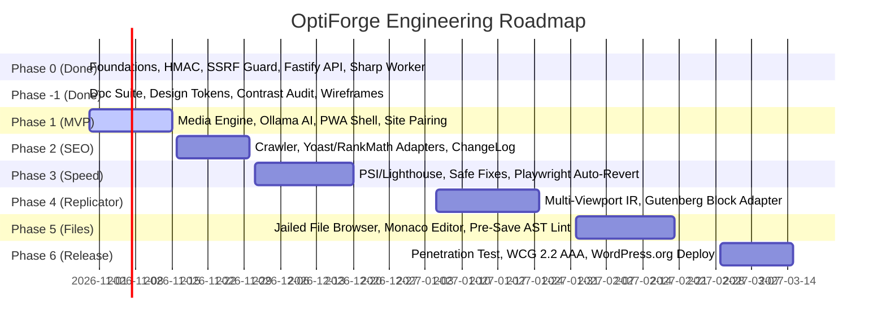

# OptiForge Product Roadmap

**Status:** ACTIVE  
**Owner-persona:** Lead Product Architect  
**Last-reviewed:** 2026-10-29  
**Applies-to-version:** v0.1.0-alpha  
**Related-docs:** [PRD.md](file:///home/dayshift/Pictures/Mimic%20Manager/docs/product/PRD.md), [docs/project/PLAN.md](file:///home/dayshift/Pictures/Mimic%20Manager/docs/project/PLAN.md)

---

## Release Horizons

---

## Milestones Details

### Milestone 1: v0.2.0-beta (Phase 1 MVP)
- Target: Full Media Optimization (WebP/AVIF) + Local GD fallback.
- Contextual AI Alt-Text generation via Ollama (moondream / qwen2-vl) + Heuristic fallback.
- Dark-first PWA dashboard with 6-digit site pairing and live job streaming.

### Milestone 2: v0.4.0-beta (Phase 2 & 3: SEO + Speed Engine)
- Plugin-aware SEO gap fill with Yoast, Rank Math, SEOPress adapters.
- Safe-tier speed fixes (dimensions, lazy loading, font-display).
- Moderate-tier fixes with Playwright preview verification and automated rollback.

### Milestone 3: v0.6.0-beta (Phase 4: UI Replicator)
- Multi-viewport DOM Intermediate Representation (IR).
- Gutenberg Core block compilation with roundtrip `@wordpress/blocks` validation.
- Interactive section picker on live rendered screenshots.

### Milestone 4: v0.8.0-beta (Phase 5: Visual File Manager)
- Jailed filesystem navigator (`wp-content` boundary).
- Monaco code editor with pre-save `php -l` syntax check and automatic rollback backups.

### Milestone 5: v1.0.0-ga (Phase 6: Hardening & Distribution)
- Independent penetration testing audit (`docs/security/SECURITY_REVIEW.md`).
- WordPress.org official plugin directory submission.
- Zero-downtime containerized self-hosting script.
